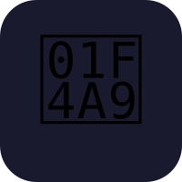

# CrapChat 💩

**Video chat from the throne.** A novelty (but fully functional) WebRTC video chat with virtual backgrounds, a pre-call **Throne Room** preview, and an optional **Fart Silencer**.



## Features

- **1:1 and small-group (up to 4) WebRTC calls** with a Node.js signaling server (Express + Socket.IO)
- **Room links / codes** — create a session or join with a short code
- **Background replacement** via MediaPipe Selfie Segmentation, composited on a canvas; the canvas stream is what peers receive
- **30 built-in scenes** (office, home, nature, urban, fun) — procedural SVGs shipped in the repo (no hotlinking)
- **Custom background upload** stored in IndexedDB
- **Throne Room** pre-call mirror to flip through scenes before joining
- **Fart Silencer** — `noiseSuppression` constraints + Web Audio highpass/lowpass + noise gate
- **Flush** emergency button — instant Business Office background + mute
- **Simple flush-sound auto-detect** (loud RMS burst → stealth flush)
- **Sit Time** call timer, **emoji reactions**, flush sound/animation on hang-up
- Mobile-first UI, **💩** logo / favicon, **Bungee** wordmark (fonts bundled locally)


## Branding

- **Logo / favicon / splash:** 💩
- **Wordmark font:** [Bungee](https://fonts.google.com/specimen/Bungee) (bundled under `public/assets/fonts/`; Fredoka for UI)
- **Palette — Throne Royal:** deep plum `#12081f`, coral `#ff6b35`, violet `#7c3aed`, gold `#ffd166`, mint `#06d6a0`

## Quick start

```bash
cd crapchat
npm install
npm start
```

Open **http://localhost:3000** (or the printed port).

> **Camera/mic require a secure context:** `localhost` is fine for development. For phones on your LAN or any public deploy, you need **HTTPS**.

### Regenerating backgrounds

```bash
npm run generate-backgrounds
```

## Deploy

Set `PORT` if your host requires it (default `3000`). Serve the same Node process (it hosts static files + Socket.IO).

### Render

1. New **Web Service**, connect this repo
2. Build: `npm install`
3. Start: `npm start`
4. Instance: Node
5. After deploy, open the `https://` URL (required for getUserMedia)

### Railway

1. New project → deploy from repo
2. Start command: `npm start`
3. Railway provides HTTPS by default

### Fly.io

```bash
fly launch
fly deploy
```

Ensure the `Dockerfile` or fly.toml starts `node server/index.js` and exposes `PORT`.

### Docker (optional sketch)

```dockerfile
FROM node:20-alpine
WORKDIR /app
COPY package*.json ./
RUN npm ci --omit=dev
COPY . .
ENV PORT=3000
EXPOSE 3000
CMD ["npm", "start"]
```

## Project layout

```
server/index.js          Signaling + static host
public/index.html        App shell
public/css/              Throne Royal theme + bundled fonts CSS
public/js/               Client modules (WebRTC, segmentation, audio, UI)
public/assets/backgrounds/  30 SVG scenes + manifest.json
public/assets/fonts/     Bungee + Fredoka (local)
scripts/generate-backgrounds.js
```

## Browser notes

- Best in Chromium / Chrome / Edge; Firefox works for WebRTC (segmentation CDN may vary)
- If MediaPipe fails to load, a soft oval matte fallback still shows backgrounds
- STUN only by default (Google public STUN). For strict NATs, add your own TURN to `public/js/webrtc.js`

## License

MIT — bathroom judgment not included.
